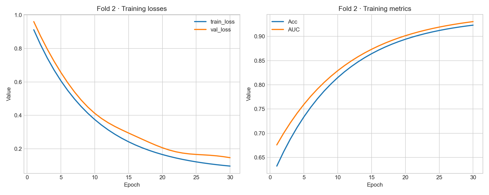

# 训练与损失曲线绘图

**把训练日志或 CSV 转成每折独立的 PNG 曲线图。** 支持损失分量、训练/验证损失以及日志中已有的训练指标，便于检查收敛过程。



Python · Matplotlib · CSV / 日志解析 · 无图形界面导出

## 快速运行

Python 3.10+，在仓库目录执行：

```sh
python -m pip install -r requirements.txt
python plot_curves.py examples/training.csv --output outputs/csv
python plot_curves.py examples/training.log --output outputs/log
```

所有示例都是合成数据。默认不覆盖已有图片；需要更新时显式加 `--overwrite`。

CSV 的 `epoch` 必须为非负整数，`fold` 可选，其他列为数值；至少有一个名称含 `loss` 的列。支持只有 `epoch,loss` 的最小输入。日志兼容原脚本的 `uni/multi/mmc/total_loss` 格式，以及 `Epoch 1 loss=...` 格式。`Fold N` 开始一折，原日志中位于训练结束后的 `fold N, test_loss=...` 也能保留实际折号。

## 实现与修复

- 将两个散落脚本整理为命令行工具，输入和输出均可指定。
- 支持空格、正负号、小数和科学计数法，移除固定指标间距和必填 AUC 的限制。
- 遇到损坏的 epoch 行、无穷值、缺失列或重复 epoch 会报错，避免静默丢数据。
- 按 epoch 排序；检查同一折的指标列一致，保留真实 fold ID。
- 使用 Agg 后端，适合服务器导出；保存后关闭图形，保护已有文件。

## 检查

```sh
python -m unittest discover -s tests -v
```

测试覆盖两种输入、折号、异常数据、PNG 导出与覆盖保护，并检查实际传给绘图库的 epoch 和数值。首页图片由此工具实际生成，数据不来自未公开实验。

## 项目来源

从个人训练日志绘图脚本整理，使用 AI 辅助开发。项目范围仅为训练曲线绘制，没有扩展为模型训练或实验统计平台。

[作品集首页](https://github.com/WULUWA-233/computer-portfolio)
